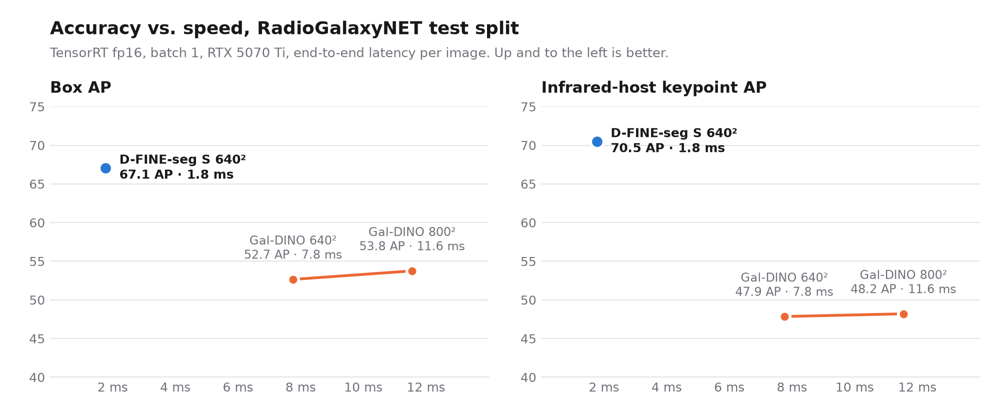
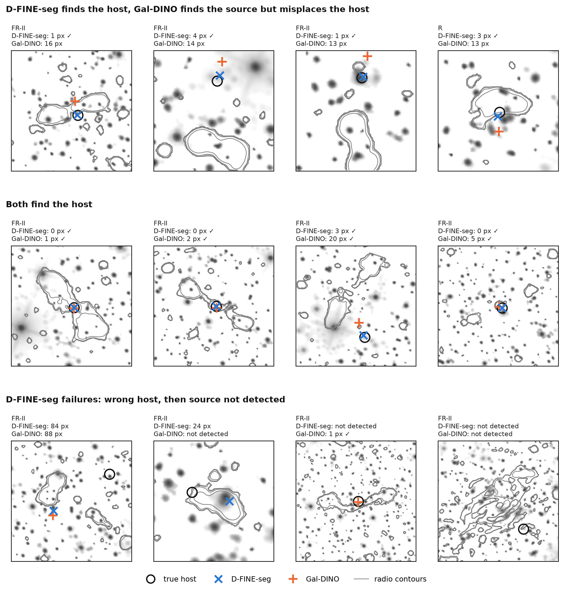

# D-FINE-seg vs Gal-DINO on RadioGalaxyNET

Code to reproduce a comparison between [D-FINE-seg](https://github.com/ArgoHA/D-FINE-seg) S (keypoint task) and [Gal-DINO](https://github.com/Nikhel1/Gal-DINO), the published model for RadioGalaxyNET ([PASA 2024](https://doi.org/10.1017/pasa.2023.64), arXiv 2312.00306). Both models predict a box per radio galaxy (4 classes: FR-I, FR-II, FR-X, R) and one keypoint for its infrared host. Both are scored on the test split with Gal-DINO's own evaluation, reproduced exactly in `score.py`.

See the model on held-out images (the "Radio galaxies and their hosts" card) at [dfine-seg.argoai.space](https://dfine-seg.argoai.space).

## Results

| model | params | input | box AP | IR-host keypoint AP | latency |
|---|---|---|---|---|---|
| Gal-DINO (published model) | 47 M | 800² | 53.8 | 48.2 | 11.6 ms |
| **D-FINE-seg S** | 13.4 M | 640² | **67.1** | **70.5** | **1.8 ms** |

Test split (420 images, 611 sources), both models in TensorRT fp16 on an RTX 5070 Ti and scored with Gal-DINO's own evaluation. D-FINE-seg S is +13.3 box AP and +22.3 keypoint AP ahead, 6.5x faster end to end, with 3.5x fewer parameters. Over three training seeds it scores 66.4 ± 0.7 box AP and 70.9 ± 0.4 keypoint AP.

<picture>
  <source media="(prefers-color-scheme: dark)" srcset="figures/speed_accuracy_dark.png">
  
</picture>

### All results

Both models are scored the same way: Gal-DINO's own evaluation of each model's full top-300 detections per image, with no NMS (see [NMS](#nms-protocol-and-robustness-check)). Latency: RTX 5070 Ti, TensorRT 10.13.3.9 fp16, batch 1, idle GPU, mean over the 420 test images. The PyTorch rows show that the TensorRT export keeps accuracy, and give the seed spread (the extra seeds were not exported).

| model | params | input | box AP / AP50 / AP75 | IR-host kpt AP / AP50 / AP75 | e2e ms | engine ms |
|---|---|---|---|---|---|---|
| Gal-DINO, paper (Table 2) | 47 M | 800² | 53.7 / 60.2 / 58.9 | 48.1 / 53.4 / 48.4 | | |
| Gal-DINO, released checkpoint, `main.py --eval` | 47 M | 800² | 53.73 / 60.18 / 58.91 | 48.14 / 53.41 / 48.50 | | |
| Gal-DINO, TensorRT fp16 | 47 M | 800² | 53.75 / 60.18 / 58.89 | 48.20 / 53.40 / 48.83 | 11.56 | 11.69 |
| Gal-DINO, TensorRT fp16 | 47 M | 640² | 52.65 / 61.10 / 59.78 | 47.85 / 54.94 / 49.86 | 7.76 | 8.02 |
| D-FINE-seg S, PyTorch | 13.4 M | 640² | 67.21 / 73.5 / 69.0 | 70.45 / 72.5 / 71.3 | | |
| D-FINE-seg S, PyTorch, 3 seeds (mean ± SD) | 13.4 M | 640² | 66.4 ± 0.7 / 73.7 / 68.3 | 70.9 ± 0.4 / 72.6 / 71.8 | | |
| **D-FINE-seg S, TensorRT fp16** | 13.4 M | 640² | **67.07 / 73.5 / 69.1** | **70.50 / 72.5 / 71.4** | **1.77** | **1.62** |

- **e2e**: one call of each framework's own inference path. It starts from a decoded uint8 image in RAM and ends with final boxes, scores, labels and keypoints on the CPU, so preprocessing, the network, postprocessing and the device-to-host copy are all included. **engine**: TensorRT execute only, timed with the same loop for both models (`measure_engine.py`, median).
- The images are 450×450, and both models upscale them. Gal-DINO at 640 is the same released checkpoint run at a smaller test size, not retrained. At equal 640 input, D-FINE-seg S scores +14.4 box AP and +22.7 keypoint AP, and is 4.4x faster e2e (4.9x engine-only).
- The same paper's Gal-YOLOv8 (Table 4, no keypoints) has the best published box AP: 54.5 / 58.5 / 57.2 (APS 45.5, APM 55.4, APL 34.0). D-FINE-seg S is +12.6 box AP above it. This repo reproduces Gal-DINO only, because it is the published model that also predicts hosts.
- Size bins are small and noisy (only 68 large test objects), but D-FINE-seg S leads in all of them: box APS / APM / APL 58.5 / 69.1 / 44.6 vs Gal-DINO's 41.5 / 56.7 / 36.3, keypoint APS / APM / APL 36.4 / 96.6 / 98.5 vs 17.6 / 81.6 / 88.8 (TensorRT rows). `score.py` prints every bin.
- Seeds: the released model is seed 42, the first run. Seeds 1 and 2, with the same config, scored 66.1 and 66.0 box AP and 71.2 and 71.0 keypoint AP (PyTorch, test). The worst of the three runs is still +12.3 box AP and +22.2 keypoint AP above Gal-DINO.

## NMS: protocol and robustness check

Gal-DINO's evaluation submits its top 300 (query, class) pairs per image without NMS, so one box can appear under several classes. COCO AP scores each class separately, so this raises recall where the class is ambiguous (FR-I, FR-II, FR-X). D-FINE-seg produces the same kind of output (top 300 over queries × classes), and this repo scores both models that way.

As a check, `score.py --nms 0.7` applies D-FINE-seg's built-in class-agnostic NMS (IoU 0.7) to any results file before scoring. On D-FINE-seg it gives exactly the same numbers as the model's own NMS. With NMS on both models (TensorRT fp16, test):

| model | input | box AP | IR-host kpt AP |
|---|---|---|---|
| Gal-DINO | 800² | 43.99 | 39.50 |
| Gal-DINO | 640² | 43.26 | 39.19 |
| D-FINE-seg S | 640² | 58.33 | 61.55 |

The lead holds under both protocols: +13.3 box and +22.3 keypoint AP without NMS, and +14.3 and +22.1 with it (vs Gal-DINO at 800). With NMS on, D-FINE-seg's e2e latency is 1.90 ms.

## Host examples



`figures/make_speed_chart.py` draws the accuracy vs. speed chart from the TensorRT rows of the table. `figures/make_figure.py` draws the host figure from the bundled TensorRT predictions (no NMS for either model). Each model runs at its own confidence threshold, the one that maximizes box F1 on the val split (D-FINE-seg 0.77, Gal-DINO 0.33), because the two models calibrate their scores very differently. A source counts as identified when it is detected (same class, IoU ≥ 0.5, one-to-one) and the predicted host has OKS ≥ 0.5, the benchmark's own rule. Of the 608 test sources whose host is inside the image, D-FINE-seg identifies 437 (71.9%) and Gal-DINO 365 (60.0%): 329 by both, 108 by D-FINE-seg only, 36 by Gal-DINO only. Test box F1: 0.716 vs 0.627.

## Quick check: score the bundled predictions (no GPU, no models)

`predictions/` holds the raw test-set outputs behind every row above, in the COCO results format, plus the val-set TensorRT outputs that the figure uses to pick its thresholds. Scoring them needs only the test annotations and pycocotools:

```bash
pip install pycocotools numpy
python data/download.py     # RadioGalaxyNET from CSIRO DAP into data/RadioGalaxyNET (~270 MB)
python verify.py            # scores the test files, with and without NMS, and checks them against the tables
python score.py data/RadioGalaxyNET/annotations/test.json predictions/galdino_trt_fp16_800_test.json.gz
```

## Reproduce D-FINE-seg

The environment is `dfine-seg==0.7.0` from PyPI, the version that trained the model (`uv sync`, Python 3.11 to 3.13, NVIDIA GPU, Linux x86_64 for TensorRT).

```bash
uv sync
mkdir -p weights && curl -L -o weights/model.pt https://huggingface.co/ArgoSA/dfine-seg-radio-galaxy-net/resolve/main/model.pt

# accuracy, PyTorch
uv run python dfine/predict.py --model weights/model.pt --out dfine_torch.json
uv run python score.py data/RadioGalaxyNET/annotations/test.json dfine_torch.json

# TensorRT fp16 export (engines are GPU-specific, so build on your own GPU)
DFINE_SEG_CONFIG_DIR=dfine uv run dfine export train.path_to_save=$PWD/weights "export.formats=[tensorrt]"
uv run python dfine/predict.py --model weights/model.engine --out dfine_trt.json
uv run python score.py data/RadioGalaxyNET/annotations/test.json dfine_trt.json
uv run python score.py data/RadioGalaxyNET/annotations/test.json dfine_trt.json --nms 0.7   # robustness row

# latency
uv run python dfine/predict.py --model weights/model.engine --latency --conf 0.5 --repeats 3
uv run python measure_engine.py weights/model.engine
```

`predict.py` runs without NMS by default, the same protocol as Gal-DINO (`--nms 1` turns D-FINE-seg's NMS back on). Scoring runs at confidence 0.001, because COCO AP needs the low-score tail (Gal-DINO submits its full top 300 per image). Latency runs at 0.5, the operating point, for both models.

`pyproject.toml` pins torch 2.13.0 and a few other packages to the versions behind the reported numbers. In a clean checkout, the PyTorch numbers reproduce exactly (67.21 / 70.45). A rebuilt fp16 engine scored 67.0 box AP and 70.4 keypoint AP, at 1.75 ms e2e and 1.59 ms engine-only. TensorRT picks kernels at build time, so each rebuild can move AP by about 0.1. A newer torch (2.15) shifted PyTorch AP by about 0.3.

### Train it yourself (about 1 hour on one RTX 5070 Ti)

```bash
python data/build_dfine_dataset.py                 # data/dataset: symlinked images + COCO JSONs
DFINE_SEG_CONFIG_DIR=dfine uv run dfine train      # 75 epochs, best checkpoint by val -> output/models/
```

The config is `dfine/config.yaml`: S model, COCO-detection init (auto-downloaded), 640² input, one keypoint with OKS sigma 0.107 (Gal-DINO's value), flips and 90° rotations. Photometric augmentations are off because the image channels encode radio intensity. The best checkpoint is picked on the val split. The released model is seed 42, the first run. Two more seeds (1, 2) with the same config scored, in PyTorch on test, 66.1 and 66.0 box AP and 71.2 and 71.0 keypoint AP; over the three seeds that is 66.4 ± 0.7 box AP and 70.9 ± 0.4 keypoint AP (mean ± sample SD). Expect a retrain to land anywhere in that range.

`build_dfine_dataset.py` makes two geometry-only fixes to the training copy, because D-FINE-seg's augmentation pipeline rejects boxes outside the image: boxes and polygons are clipped to the image (40 boxes overshoot by at most 1 px), and the 17 host keypoints that lie outside the image (3 of them in test) are marked unlabeled. Scoring always uses the original JSON, where those 3 test hosts cannot be matched by any model.

## Reproduce Gal-DINO

1. Download the authors' checkpoint from [figshare](https://figshare.com/s/01dd33b8ff14ffc32dd5) (linked from the Gal-DINO README).
2. Run `galdino/setup.sh`. It clones the official repo at a fixed commit into `galdino/Gal-DINO`, applies `galdino/patches.diff`, creates a venv (Python 3.12, torch 2.11 cu128, `galdino/requirements.txt`), builds the deformable-attention CUDA op (needs `nvcc` 12.x) and links the dataset. The patch has two compatibility fixes for newer PyTorch and changes no model behavior: it allows `argparse.Namespace` in `torch.load`, and replaces the removed `Tensor.type()` with `scalar_type()` in the CUDA op.
3. Put the checkpoint at `galdino/Gal-DINO/outputs_gal/checkpoint.pth`.

Then, from `galdino/Gal-DINO`:

```bash
# Gal-DINO's own evaluation (main.py --eval, unchanged); also saves the scored predictions
.venv/bin/python dump_eval.py --split test --out runs/torch_test
.venv/bin/python score.py ../../data/RadioGalaxyNET/annotations/test.json runs/torch_test/results.json

# TensorRT fp16 at the published 800 input
.venv/bin/python export_onnx.py                                   # export/galdino.onnx
.venv/bin/python build_trt.py --fp16 --out export/galdino_fp16.engine
.venv/bin/python eval_backends.py --backend trt --engine export/galdino_fp16.engine --preproc gpu --split test
.venv/bin/python latency.py --engine export/galdino_fp16.engine --preproc gpu --conf 0.5

# the same at 640 (same checkpoint, smaller test size)
GALDINO_SIZE=640 .venv/bin/python export_onnx.py                  # export/galdino_640.onnx
.venv/bin/python build_trt.py --fp16 --onnx export/galdino_640.onnx --out export/galdino_fp16_640.engine
GALDINO_SIZE=640 .venv/bin/python eval_backends.py --backend trt --engine export/galdino_fp16_640.engine --preproc gpu --split test
GALDINO_SIZE=640 .venv/bin/python latency.py --engine export/galdino_fp16_640.engine --preproc gpu --conf 0.5
```

In a clean run of these steps, `main.py --eval` reproduced its numbers exactly (53.73 / 48.14). A rebuilt fp16 engine scored 53.78 / 48.10, at 11.56 ms e2e and 11.61 ms engine-only. As with D-FINE-seg, each engine rebuild can move AP by about 0.1.

Engine-only timing uses the shared timer from the repo root (any env with TensorRT 10.13.3.9): `python measure_engine.py galdino/Gal-DINO/export/galdino_fp16.engine`.

How the Gal-DINO TensorRT path is built:

- The custom deformable-attention CUDA op is replaced by the repo's own pure-PyTorch `grid_sample` implementation (same math) so that the model exports to ONNX. Gal-DINO's `PostProcess` (sigmoid, top 300 over queries × classes) runs inside the graph.
- Preprocessing matches Gal-DINO's test transform (resize the short side to 800, normalize with the radio mean and std), done on the GPU. The engine runs as a CUDA-graph replay. This is the fastest honest path we found for Gal-DINO. D-FINE-seg uses its shipped `TRTModel` wrapper, without CUDA graphs.
- `eval_backends.py` can also run the PyTorch, ONNX Runtime and TensorRT backends with Gal-DINO's original PIL preprocessing. All of them land within 0.1 AP of `main.py`.

## Scoring protocol

`SCORING.md` documents the protocol in full. In short: pycocotools `COCOeval`, run once for boxes and once for keypoints, with Gal-DINO's overrides (area ranges 24² and 48², OKS sigma 0.107, default maxDets), on the original test JSON. It also reproduces one detail of Gal-DINO's evaluation: keypoint results are loaded without boxes. Because of that, unmatched keypoint detections are not penalized in the medium and large rows, which is why keypoint APM and APL are much higher than keypoint AP for every model. On test and val, `score.py` matches all 22 numbers that `main.py --eval` prints, exactly. No NMS is applied to either model; `--nms IOU` exists only for the robustness check above.

## Notes on fairness

- Both models are scored by the same scorer under the same protocol (full top-300, no NMS), and each runs its own pre- and postprocessing.
- Training budgets differ: Gal-DINO's released checkpoint was trained for 30 epochs at batch 2 (from its saved arguments), and D-FINE-seg for 75 epochs (about 45 s per epoch). Both start from COCO-pretrained detectors.
- Latency was measured back to back on an idle GPU.

## Licenses and citation

- This repo: Apache-2.0. The scripts in `galdino/` work with Gal-DINO's code, which is Apache-2.0.
- RadioGalaxyNET is CC BY-NC-SA 4.0 and is not redistributed here; `data/download.py` fetches it from [CSIRO DAP](https://doi.org/10.25919/btk3-vx79). The D-FINE-seg weights ([Hugging Face](https://huggingface.co/ArgoSA/dfine-seg-radio-galaxy-net)) are Apache-2.0.
- If you use this comparison, please cite the RadioGalaxyNET / Gal-DINO paper: [doi:10.1017/pasa.2023.64](https://doi.org/10.1017/pasa.2023.64).
